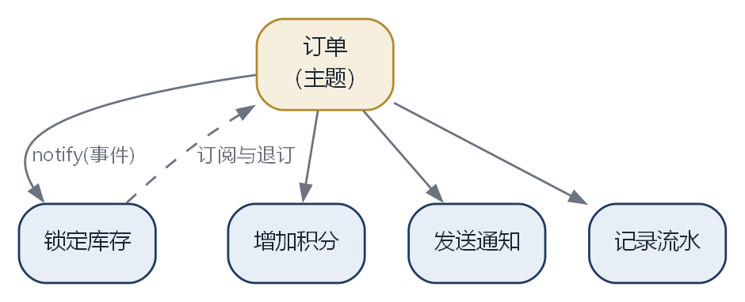

# 第 19 章 观察者：一个对象变化，通知所有关心它的对象

## 19.1 订单状态变了之后

一个电商后台，订单状态会变：待付款、已付款、已发货、已签收、已取消。

每种变化都有一串后续动作。

```text
func pay_success(order):
    order.status = PAID
    inventory.lock(order.items)        // 库存
    points.add(order.user, order.amount) // 积分
    message.send(order.user, "支付成功")  // 通知
    finance.record(order)              // 记账
    push.to_warehouse(order)           // 推给仓库
```

一开始只有四个动作。半年后，运营要加“发送优惠券”“更新用户画像”“写入数据平台”“触发自动评价提醒”。这个函数变成了十几个依赖，每个模块都被它直接引用。

出问题的时候也很麻烦。积分服务挂了，异常往上抛，库存已经锁了，订单却停在中间状态。想加一个“这步失败就跳过”的策略，得改这个函数本身。

## 19.2 让关心的人自己登记

观察者模式的思路是：状态变化的对象不直接调用这些模块，而是维护一份“关心我的人”的名单，变化时挨个通知。谁关心，谁自己来登记。

它包含两个角色。

**主题。** 状态的所有者。它提供订阅、退订、通知三个方法，内部维护一个观察者列表。

**观察者。** 关心状态的一方。它实现一个更新方法，收到通知时执行自己的逻辑。

用结构描述。

```text
interface Observer
  on_event(event)

class OrderSubject
  observers : list
  subscribe(o)   { observers.add(o) }
  unsubscribe(o) { observers.remove(o) }
  notify(event)
    for o in observers:
        try { o.on_event(event) } catch e { log(e) }

class InventoryObserver implements Observer
  on_event(e) { if e.type == "paid": lock(e.order.items) }

class PointsObserver implements Observer
  on_event(e) { if e.type == "paid": add(e.order.user, e.order.amount) }

class NotifyObserver implements Observer
  on_event(e) { send(e.order.user, text_of(e)) }
```

订单对象只认识 `Observer` 这个接口，不认识库存、积分、消息中的任何一个。



## 19.3 协作过程

1. 系统启动时，各模块向订单主题登记自己。
2. 用户支付成功，订单主题把状态改成已付款。
3. 主题遍历名单，逐个调用 `on_event`，把事件对象传过去。
4. 库存观察者锁库存，积分观察者加积分，通知观察者发短信。
5. 某个观察者抛异常，主题捕获后记日志，继续通知下一个。

第 5 步很重要。**通知过程不能因为一个订阅者出错就中断**，否则一个模块的 bug 会拖垮整条链路。代价是错误被吞掉了，所以失败必须留下痕迹：记日志、计数、留下重试或者补偿的线索。

## 19.4 推还是拉

通知的时候，主题告诉观察者多少信息，有两种方式。

**推。** 主题把事件对象整个传过去，观察者从里面取需要的东西。优点是观察者不用回查，一次调用拿到全部信息。缺点是事件对象会随着需求变胖，所有观察者都得跟着它的结构走。

**拉。** 主题只告诉观察者“变了”，观察者自己拿主题的引用去查。优点是主题不用预设别人要什么。缺点是观察者要回查，可能查到已经变过几次的中间状态，还要处理并发。

实际系统里常用混合：推一个精简的事件（类型 + 关键 id），观察者需要更多细节时再回查。这样事件结构稳定，细节可以按需取。

## 19.5 顺序与并发

观察者的执行顺序，默认是不保证的。这带来两个问题。

**有依赖的动作会错序。** 比如“扣减库存”必须在“锁定库存”之后。如果两个观察者的顺序反了，业务就错了。

解决办法不是给观察者排序，而是**把它们合并成一个观察者**。有先后依赖的动作，本质上是同一个流程的几步，不该拆成互不相识的订阅者。顺序依赖是流程，不是通知。

**并发修改名单。** 通知过程中有观察者订阅或者退订，会破坏遍历。常见做法是遍历副本，或者延迟到本轮结束再应用变更。

**同步还是异步。** 同步通知简单，但一个慢观察者会拖慢整个链路。异步通知快，但要处理队列积压、顺序丢失、失败重试。判断标准是：这一步失败能不能接受、用户要不要等它完成。支付成功页不需要等积分到账，可以异步；库存锁定必须在返回前完成，要同步。

## 19.6 忘了退订

这是观察者模式最常见的内存泄漏来源。

观察者被主题的列表强引用。观察者所属的窗口关了、页面销毁了、插件卸载了，但没从名单里删掉。主题一直活着，观察者就永远回收不了。

几种防护。

**订阅时返回一个句柄。** 句柄销毁时自动退订，配合语言的析构或者作用域退出。

**弱引用。** 主题只持弱引用，观察者被回收后自动从名单里消失。要注意遍历时需要判断是否已失效。

**生命周期绑定。** 主题和观察者的生命周期由同一个容器管理，容器销毁时统一注销。

最根本的还是一条约定：**谁订阅，谁负责退订**。把这句话写进接口文档，比事后查内存泄漏便宜得多。

## 19.7 通知风暴

观察者一多，会出现连锁反应。

A 变化通知 B，B 处理时又改了 A，A 再通知一轮。或者一次批量导入触发了十万次单条通知。

几种控制。

**合并。** 一段时间内的多次变化合并成一次通知，比如每 100 毫秒最多通知一次。

**去重。** 同一个观察者在同一轮里只通知一次。

**限制深度。** 通知里再触发通知，超过一定层数就报错，防止无限递归。

**批量事件。** 批量操作发一个“批量变更”事件，让观察者自己决定怎么处理，而不是发一万条单条事件。

这些手段本质上都在做一件事：把“变化”的粒度调粗。粒度太细，通知成本会超过业务本身。

## 19.8 与发布订阅的区别

两者结构相似，边界不同。

**观察者**里，主题直接持有观察者列表，双方互相知道。通常是同一个进程内，同步调用。

**发布订阅**中间有一个消息通道。发布者只往通道里发，订阅者只从通道里收，双方互不认识，可以跨进程、跨机器。

观察者是发布订阅的进程内简化版。系统还小的时候用观察者，需要解耦、需要跨进程、需要持久化的时候再升级成消息中间件。提前上中间件，运维成本会先压过来。

## 19.9 什么时候不该用它

**只有一两个固定的下游。** 直接调用更清楚，调试时一眼能看到调用链。

**需要严格的事务性。** 通知是“发出去就不管结果”，如果几个动作必须同时成功或同时失败，应该用事务或者两阶段提交，而不是观察者。

**调用方需要拿到返回值。** 观察者的更新方法是单向的，不适合“问一个问题、等一个答案”的场景。

**变化极频繁、下游很多。** 每次变化都广播给几十个订阅者，成本会失控。这时候需要在中间加一层聚合或者脏标记，而不是继续堆订阅者。

## 19.10 一个判断标准

要不要用观察者，看三点。

第一，变化的一方不该知道有多少人关心它？是，这是它最主要的理由。

第二，下游的数量和种类会持续增加？会，登记制让新增下游不用改主题。

第三，能接受“通知发出后不保证结果”？能，观察者合适；不能，先把流程做成显式调用或者事务。

一句话：观察者解的是“一对多的通知”，不是“一对多的协作”。需要协作、需要顺序、需要结果，就不该用它。
