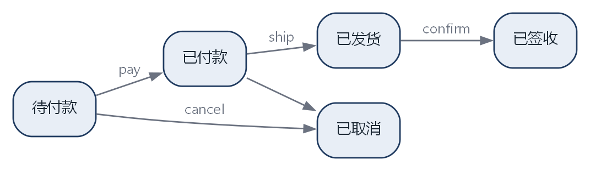

# 第 20 章 状态：对象的行为随内部状态改变而改变

## 20.1 一个订单的所有分支

订单有五个状态：待付款、已付款、已发货、已签收、已取消。

每个状态支持的操作不一样。

```text
func pay(order):
    if order.status != PENDING: throw "不能支付"
    order.status = PAID

func ship(order):
    if order.status != PAID: throw "不能发货"
    order.status = SHIPPED

func confirm(order):
    if order.status != SHIPPED: throw "不能确认收货"
    order.status = SIGNED

func cancel(order):
    if order.status == PENDING or order.status == PAID:
        order.status = CANCELLED
    else: throw "不能取消"
```

能跑。但需求一直在加。

“已付款”超过 24 小时未发货可以自动退款；“已签收”七天内可以申请售后；“已取消”要看是用户取消还是超时取消，退款路径不同；企业订单发货后还能改地址。

每个条件都往这些函数里塞一个 `if`。四个函数逐渐变成四个大分支树。

真正的问题是：**同一份状态判断，在四个地方各写了一遍**。想知道“已签收能不能取消”，得把四个函数都读一遍。

## 20.2 把状态本身变成对象

状态模式的思路是：把每个状态做成一个对象，这个对象知道“在这个状态下每个操作该怎么响应”，以及“响应之后该转到哪个状态”。订单本身只持有一个当前状态对象，把操作转给它。

它包含三个角色。

**上下文。** 持有当前状态的对象，这里是订单。它对外暴露业务操作，内部把操作转给当前状态。

**状态接口。** 声明一组操作，通常还有“进入这个状态”和“离开这个状态”。

**具体状态。** 每个状态一个类，实现这些操作。它可以自己决定转移到哪个状态，也可以让上下文决定。

用结构描述。

```text
interface OrderState
  pay(order)
  ship(order)
  confirm(order)
  cancel(order)

class PendingState implements OrderState
  pay(o)     { o.set_state(new PaidState()) }
  ship(o)    { throw "未付款不能发货" }
  confirm(o) { throw "未发货不能确认" }
  cancel(o)  { o.set_state(new CancelledState("user")) }

class PaidState implements OrderState
  pay(o)     { throw "已付款" }
  ship(o)    { o.set_state(new ShippedState()) }
  confirm(o) { throw "未发货" }
  cancel(o)  { o.set_state(new CancelledState("refund")) }

class ShippedState implements OrderState
  confirm(o) { o.set_state(new SignedState()) }
  cancel(o)  { throw "已发货不能取消，请走售后" }

class Order
  state
  set_state(s) { state = s; log("enter " + s.name) }
  pay()     { state.pay(this) }
  ship()    { state.ship(this) }
  confirm() { state.confirm(this) }
  cancel()  { state.cancel(this) }
```

“已签收能不能取消”这个问题，现在只需要看 `SignedState.cancel` 一个方法。



## 20.3 协作过程

1. 用户点“取消”，界面调用 `order.cancel()`。
2. 订单把调用转给当前状态对象。
3. 如果当前是“已付款”，`PaidState.cancel` 执行退款准备，然后调用 `order.set_state`。
4. 订单换成“已取消”，并把取消原因记为退款取消。
5. 状态切换时记一条日志，方便事后追查。

订单本身没有分支。所有“在什么状态下能做什么”，都分散到了各个状态类里。

## 20.4 状态存哪

这里有个容易忽略的问题：状态对象要不要保存数据。

**无状态的状态对象。** 一个状态一个单例，不保存数据，所有数据放在订单里。切换状态只是换一个对象引用。这样最省内存，适合状态多、订单多的情况。

**有状态的状态对象。** 状态对象自己保存这个阶段的上下文，比如“进入已付款的时间”“重试了几次”。切换状态时这些数据跟着丢。

**混合。** 跨状态需要的数据放订单，只在当前状态有效的数据放状态对象。

选择依据是数据的生命周期。要跨状态用的，比如订单号、金额，放订单；只在一个阶段用的，比如“发货失败重试计数”，可以让状态对象持有，或者单独放一个字段并在切换时清空。

## 20.5 状态转移放在哪

转移可以由状态自己发起，也可以由上下文统管。

**状态自己决定。** 每个状态知道自己的后继。新增状态时，改的是状态类，订单不用动。缺点是状态之间的跳转关系分散在各处，画不出一张完整的状态图。

**上下文统管。** 订单里有一张转移表，规定“当前状态 + 操作 = 新状态”。状态对象只负责这一状态下该做的事，不负责决定转去哪。优点是整个状态机一目了然，可以做校验、可以做可视化。缺点是订单要改。

**用表驱动。** 转移表写成配置，代码只负责查表。状态多、规则常改时，这种方式最好维护。

经验上：状态少、转移简单，让状态自己决定；状态多、要审计、要可视化，用转移表。

## 20.6 状态机不等于状态模式

状态模式只是实现状态机的一种方式，而且不是最省事的那种。

如果只是“状态之间严格按顺序转换，没有分支”，一个 `switch` 加一张表就够了，不需要十个类。

如果只是“几个布尔标记的组合”，比如“是否已付款”“是否已发货”，那更不需要状态对象，几个字段加校验就行。

状态模式真正划算的场合是：**每个状态下的行为差异很大，而且状态会继续增加**。比如审批流，每个节点有自己的表单、自己的权限、自己的超时策略。硬写分支会长成一棵大树，状态对象能把每个状态的逻辑收在一处。

## 20.7 与策略的区别

两者的结构几乎一样：上下文持有一个接口，接口有多个实现。

**策略**里的实现是可以互相替换的算法，上下文不知道也不关心当前是哪个，换一个不影响上下文的行为语义。

**状态**里的实现是有先后、有转移关系的阶段，上下文知道当前处于哪个阶段，切换往往由状态自己触发。

一句话：策略是“换算法”，状态是“换阶段”。策略之间通常平行，状态之间有路径。

## 20.8 与命令的区别

**命令**把一次操作封装成对象，重点是操作本身可以被排队、记录、撤销。

**状态**把一种情境下的响应封装成对象，重点是情境决定行为。

有些系统会混用：状态对象在处理操作时生成命令对象，交给队列执行。这样撤销和状态转移就能分开管理。

## 20.9 什么时候不该用它

**状态只有两三个，转移固定。** 两个状态的开关，一个布尔字段就够了。

**行为在不同状态下差别很小。** 如果只是返回值不同、其他都一样，把差异收进一张表，比十个类轻。

**状态会被频繁序列化。** 状态模式让状态变成了对象，存数据库时只能存状态名，读回来要重新构造。如果系统里到处在存状态，用枚举加分支可能更省事。

**状态转移规则会频繁变化，而且要求可配置。** 这时候该用状态机引擎或者规则表，不是手写一堆状态类。

## 20.10 一个判断标准

要不要用状态，看三点。

第一，同一个操作在不同状态下要做不同的事？是，这是它存在的理由。

第二，状态的数量和分支还在增长？是，把分支拆成对象能止住膨胀。

第三，状态之间的转移是有路径的，不是随便切换？是，状态模式能顺便把转移管起来；不是，先确认这是状态还是标签。

判断的核心：分支多到读不下去，才值得为每个分支建一个对象。
