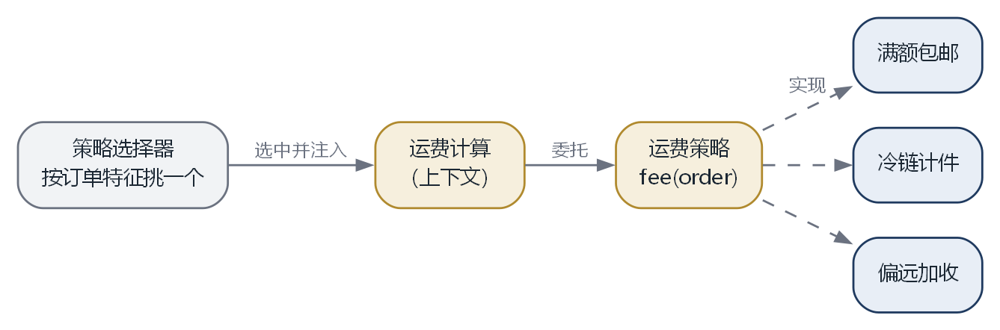
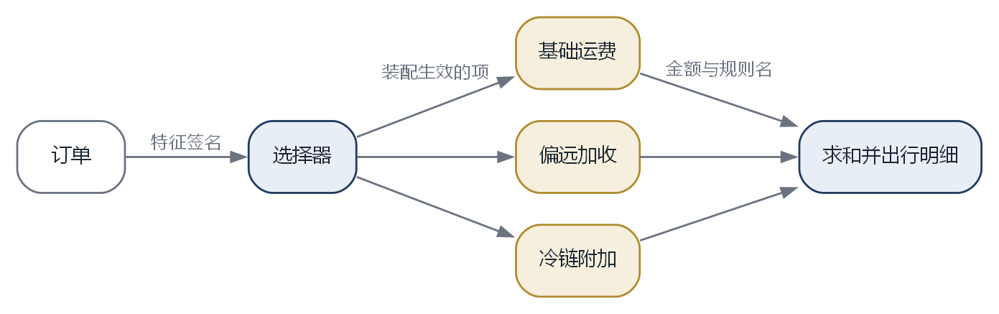

# 第 21 章 策略：把可替换的算法独立出来

## 21.1 运费怎么算

一个商城要算运费，规则一直在加。

最初只有一种：满 99 包邮，不满收 10 元。

```text
func shipping_fee(order):
    if order.total >= 99: return 0
    return 10
```

后来陆续加了几种。偏远地区加收 15 元。生鲜必须冷链，按件收 8 元。大件走物流，按体积算。会员包月免运费。双十一全场包邮但除外偏远地区。

函数变成这样。

```text
func shipping_fee(order):
    if is_promotion_day() and not is_remote(order.address):
        return 0
    if order.user.is_monthly_member: return 0
    if order.category == "fresh":
        return 8 * order.item_count
    if order.is_bulky:
        return volume_of(order) * 0.6
    if is_remote(order.address):
        return 10 + 15
    if order.total >= 99: return 0
    return 10
```

规则之间还开始打架。会员和双十一谁优先？生鲜大件走冷链还是走物流？每次加规则，都要重新想一遍顺序，而且改动总是影响别人。

## 21.2 把每套算法独立成对象

策略模式的思路是：把每种算法做成一个独立对象，它们实现同一个接口，上下文持有一个算法对象，运行时可以替换。

它包含三个角色。

**策略接口。** 声明算法的方法，参数是算法需要的输入。

**具体策略。** 每种算法一个类，实现这个接口。

**上下文。** 使用算法的对象。它持有策略，把计算委托出去，自己不知道算法细节。

用结构描述。

```text
interface ShippingStrategy
  fee(order) : Money

class FlatRate        implements ShippingStrategy
  fee(o) { return o.total >= 99 ? 0 : 10 }

class RemoteSurcharge implements ShippingStrategy
  inner
  fee(o) { return inner.fee(o) + (is_remote(o.address) ? 15 : 0) }

class ColdChain       implements ShippingStrategy
  fee(o) { return 8 * o.item_count }

class MemberFree      implements ShippingStrategy
  fee(o) { return 0 }

class ShippingCalculator      // 上下文
  strategy
  set_strategy(s) { strategy = s }
  calculate(o)    { return strategy.fee(o) }
```

上面那个打架的问题，现在有了明确的答案结构：`RemoteSurcharge` 里包了另一个策略，用组合来表达“先按基础规则算，偏远再加收”。规则之间的关系变成了对象之间的组合，而不是函数里的先后顺序。

## 21.3 怎么选策略

策略独立出来之后，“选哪个”成了新问题。这个选择逻辑不能又变成一个大 if。

几种做法。

**调用方指定。** 下单时结算页显示“运费 12 元”，用的是系统按订单特征选好的策略。选择逻辑放在一个专门的“策略选择器”里。

**注册表。** 每个策略登记一个名字或者条件，选择器按条件匹配。

```text
registry.register("cold_chain", ColdChain())
registry.register("remote", RemoteSurcharge(base))
...
func choose(order):
    for rule in rules:                     // 规则按优先级排好
        if rule.matches(order): return registry.get(rule.name)
```

**配置驱动。** 规则写成配置，运营可以改优先级。这时候选择器是一个解释器（见第 15 章）。

无论哪种，关键是把“选择”和“执行”分开。上下文只管执行，选择由外部决定并注入。



## 21.4 让选择结果能解释自己

客服接到“为什么这单收二十三块”时，如果接口只返回一个金额，只能翻日志一点点还原。把明细一起返回，问题当场能解释。

```cpp
struct Line {
    std::string rule;    // 哪条规则出的这笔钱
    Money       amount;  // 可为负，表示优惠
};

struct Quote {
    Money             total;
    std::vector<Line> lines;
};
```

策略的签名从 `Money fee(order)` 改成 `Quote quote(order)`，每个策略往里追加自己的行，上下文只负责求和。看起来多写了一层结构，收益是每一次争议都能从返回值里直接读出答案。

第二条是选择结果要可缓存。按订单号缓存没意义，一单只算一次；按特征缓存才有价值，运费规则通常只依赖四五个字段。

```cpp
std::string signature(const Order& o) {
    return join(o.category, o.is_remote, o.is_member, o.is_bulky, o.total >= 99);
}
```

特征相同的订单命中同一个策略对象，缓存可以放在选择器里，也可以放在策略内部，后者要求策略本身无状态。签名里漏掉一个影响结果的字段，症状是“某类订单偶尔用错规则”，加字段时记得同步改签名。

## 21.5 协作过程

1. 用户进入结算页，系统计算运费。
2. 选择器按订单特征匹配规则，得到“冷链 + 偏远加收”的组合。
3. 选择器构造组合后的策略对象，注入计算器。
4. 计算器调用 `calculate`，委托给策略。
5. 策略算出金额返回，计算器不参与任何计算细节。

如果用户改了地址，系统重新选择策略、重新注入，计算器本身不变。

## 21.6 策略可以是简单的函数

很多语言里，策略不需要一个类。一个函数、一个闭包就是策略。

```text
calculator.set(fee = o => o.total >= 99 ? 0 : 10)
```

背后还是同一个模式：把算法作为一个值传进去。类和函数只是形态差异。

什么时候需要真正的类？当策略需要携带状态（比如持有配置、缓存、依赖），或者需要多个方法（比如“计算”和“说明文案”）时。只有一个方法的策略，用函数更轻。

## 21.7 策略与组合的关系

真实业务里的规则很少是“十选一”，更多是“叠加”。

会员免运费，但同时要收偏远加收。双十一包邮，但大件仍然按体积收费。

用组合表达比用优先级列表更清楚：策略可以装饰另一个策略（见第 9 章），也可以按顺序串起来，每个负责一段计算。这样新增规则时，只是多包一层，不改已有策略。

代价是组合出来的策略不好一眼看懂。所以组合顺序要固定，最好能打印出“当前生效的规则链”，否则出问题没人说得清这一单为什么收 23 元。

## 21.8 叠加用计费项，别硬套装饰器

组合有两种形态，选错了会很难读。

装饰器的语义是“同一件事套一层壳，输出还是同一件事”。压缩流套一层加密，结果仍是字节流，这个用法很自然。运费不是这样。基础运费、偏远加收、冷链附加，它们是**并列的几笔钱**，相加才是总价。

硬用装饰器写，“偏远加收”必须在“基础运费”之外再算一次内层结果。一旦出现“满 99 免基础运费、偏远加收照收”，内层的 0 和外层的 15 就得靠特判拼起来，代码里开始出现 `if (inner_is_free)` 这类判断。

换成项列表，语义直接对上。

```cpp
struct Charge {
    std::string name;
    std::function<Money(const Order&)> amount;   // 不适用时返回 0
};

class ShippingCalculator {
public:
    Money calculate(const Order& o) const {
        Money sum = 0;
        for (const auto& c : charges_) sum += c.amount(o);
        return sum;
    }
private:
    std::vector<Charge> charges_;
};
```

`charges_` 由选择器装配，比如基础运费、偏远加收、冷链附加。包邮的实现是“基础运费这一项返回 0”，它不需要知道别的项存不存在。新增春节附加费只是往里加一项，不改任何已有代码。

| 形态 | 语义 | 适合 | 不适合 |
|---|---|---|---|
| 装饰器 | 同接口层层包裹 | 压缩、加密、缓存这类同质增强 | 并列的多笔金额 |
| 项列表 | 并列相加 | 计价、积分、评分 | 后一步要拿前一步的结果再算 |
| 优先级列表 | 命中第一条就停 | 互斥的业务规则 | 允许同时生效的规则 |

判据是“可加还是可套”。能相加的用列表，必须包裹的用装饰器，互斥的用优先级。一个系统里三种同时存在很常见，关键是每一组规则只用一种。



## 21.9 十二个策略类，一半只差一个参数

项目里的运费策略最后长到十二个类，`FlatRate06`、`FlatRate08`、`RemoteSurcharge15`、`RemoteSurcharge20`，名字里带数字。财务每调一次费率就提一个需求，开发得加一个类、发一次版。有一段时间线上同时在跑三个版本的费率，因为不同渠道包了不同的包。

问题不在策略模式，而在于把“参数”做成了“类型”。费率、阈值、满额线都是会变的数值，不是不同的算法。

收拾分两步。第一步，把七个只差参数的类合并成一个参数化策略，参数从配置中心下发。

```cpp
class FlatRate : public ShippingStrategy {
public:
    FlatRate(Money threshold, Money price) : threshold_(threshold), price_(price) {}
    Quote quote(const Order& o) const override {
        if (o.total >= threshold_) return { 0, {{"满额包邮", 0}} };
        return { price_, {{"基础运费", price_}} };
    }
private:
    Money threshold_, price_;
};
```

第二步，保留三个真正结构不同的策略。冷链按件计、大件按体积计、会员免运费，这三者的计算方式不是参数能表达的。

改完之后，调费率是改配置，一次版都不用发。判断清单也跟着清楚了。

- 两个策略的差别能不能用一个数字或一个布尔表达？能，合并成参数。
- 策略里的数值会不会被运营在后台调？会，参数从配置来，别写在代码里。
- 两者的计算步骤是否不同，而不只是系数不同？只有系数不同，就不该建类。
- 策略是否携带自己的依赖，比如汇率表、温度区间表？携带，做成类更清楚。
- 新策略上线是否需要发版？需要，说明还停在“类型即参数”的阶段。

## 21.10 与状态的区别

结构一样，语义相反。

**状态**之间的切换由内部触发，状态之间存在转移路径，上下文的行为语义随状态改变。

**策略**之间的替换由外部决定，策略之间互相独立，上下文的行为语义不变，只是结果不同。

判断方法：如果“当前是哪个”会影响“下一步能做什么”，是状态；如果只是“用哪个算法算”，是策略。

## 21.11 与工厂的区别

**工厂**解决“对象怎么创建”。调用方说要什么，工厂返回一个实例。

**策略**解决“算法怎么替换”。对象怎么来是另一回事。

两者经常配合：工厂按配置创建策略对象，上下文拿到后使用。工厂负责造，策略负责算。

## 21.12 什么时候不该用它

**算法只有一个，或者将来也不会增加。** 直接写函数，多一层接口只是多一次跳转。

**算法之间差别很小。** 只是参数不同（比如费率从 0.6 改成 0.8），用一个参数化的算法更清楚，不必建两个类。

**选择逻辑比算法本身还复杂。** 如果选策略要判断十几个条件，那说明问题不在算法，而在业务规则本身混乱。先理顺规则，再谈抽象。

**性能极敏感。** 每单都新建策略对象、每次都虚调用，在高频路径上会成为开销。可以缓存策略实例，或者把热路径单独优化。

## 21.13 一个判断标准

要不要用策略，看三点。

第一，同一件事有几种可替换的算法？有，而且不止一两种，值得抽出来。

第二，算法会继续增加，或者需要运行时决定？会，独立成对象最省事。

第三，调用方希望不关心算法细节？希望，把选择和执行分开，上下文就不用改。

如果算法只有一种，或者差别只在参数上，别急着建接口。策略的价值在于“替换”，没有替换就没有价值。
