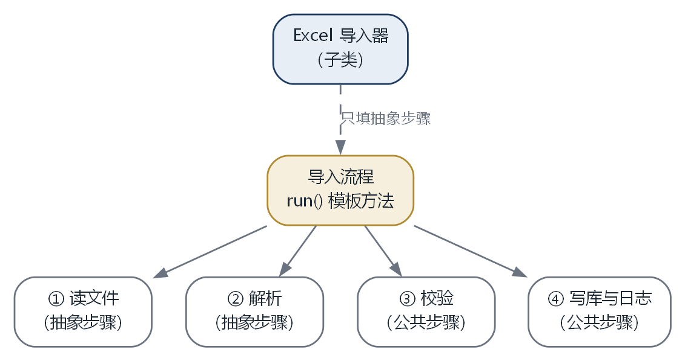
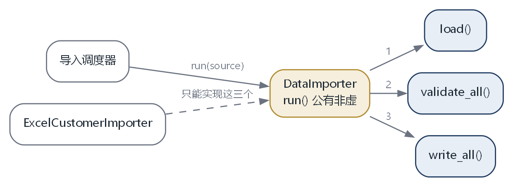

# 第 22 章 模板方法：固定流程骨架，把其中几步留给子类

## 22.1 四种数据导入

系统要支持四种数据导入，从 Excel 导客户，从 CSV 导订单，从接口导商品，从 SFTP 导对账单。

四个人各写了一个导入类。

```text
class ExcelCustomerImport
  run()
    // 打开文件
    // 读第一个 sheet
    // 按列名映射到字段
    // 校验手机号、邮箱
    // 查重，已存在的更新
    // 写库
    // 发通知
    // 记录导入日志
```

四个类打开后发现，八个步骤里有五个是一样的：打开、校验框架、查重、写库、日志，只是读文件的方式和字段映射不同。

但写法上已经不一样了。有人先删旧数据再插，有人用事务包住整批，有人失败一条就中断，有人跳过继续。查日志的时候，谁也说不清为什么两万条数据导进了数据库一万八。

## 22.2 把流程固定下来

模板方法模式的思路，是把整套流程固定在一个父类的“模板方法”里，规定每一步按什么顺序做，变化的部分留成抽象方法，由子类实现。

它包含三个角色。

**抽象类。** 定义模板方法，也就是完整流程。它调用若干步骤方法，其中有些是抽象的（必须由子类实现），有些是具体实现（公共逻辑），有些是钩子（可选覆盖）。

**具体子类。** 只实现自己那几步，不改变流程顺序。

**钩子方法。** 父类提供默认空实现，子类按需覆盖，用来微调流程中的某个决定，而不是替换整段逻辑。

用结构描述。

```text
abstract class DataImporter
  // 模板方法，final，不允许覆盖
  final run(source)
    raw      = read(source)          // 抽象：怎么读
    rows     = parse(raw)            // 抽象：怎么解析成行
    if not validate_all(rows):       // 具体：通用校验
        fail("校验不通过"); return
    begin_transaction()
    for row in rows:
        if should_skip(row): continue        // 钩子
        record = map_to_record(row)          // 抽象：字段映射
        upsert(record)                       // 具体：通用写库
        if not should_continue_on_error():   // 钩子
            break_on_error()
    commit()
    after_import(rows.count)         // 钩子
    write_log(source, rows.count)

  abstract read(source)
  abstract parse(raw)
  abstract map_to_record(row)
  validate_all(rows) { /* 通用规则 + 调用 validate_row */ }
  validate_row(row)  { /* 抽象，或默认全通过 */ }
  should_skip(row)   { return false }
  should_continue_on_error() { return true }
  after_import(n)    { }

class ExcelCustomerImporter extends DataImporter
  read(source) { return excel.open(source) }
  parse(raw)   { return excel.sheet(raw, 0).rows() }
  map_to_record(row) { return Customer(name: row["姓名"], ...) }
  validate_row(row) { /* 手机号格式 */ }
```



## 22.3 协作过程

1. 调度器创建具体的导入器，调用 `run(source)`。
2. 模板方法按固定顺序执行：读、解析、校验。
3. 校验失败，模板方法自己终止，子类不用管。
4. 校验通过，开事务，逐行写入。
5. 每行写入前问一次钩子“这行要不要跳过”，子类可以按自己的规则决定。
6. 出错时问钩子“要不要继续”，子类可以选“整批回滚”或者“跳过继续”。
7. 全部完成后统一写日志、发通知。

子类只关心三件事，怎么读、怎么映射、这一行算不算合法。流程的控制权在父类手里。

## 22.4 控制反转在这里的样子

模板方法体现了一个原则，**别调用我们，我们会调用你**。

子类不是主动去调流程，而是被流程调用。流程由父类掌握，子类填充细节。

这个方向很重要。它意味着框架可以保证“无论如何都会记日志”“无论如何都在事务里”，而使用者没法绕过。框架的约束力来自这里。

代价也来自这里：父类的流程一旦定死，子类想改顺序就没办法，只能覆盖整个模板方法，那就失去了模板的意义。

## 22.5 钩子该有多少

钩子太少，子类想微调只能整段覆盖。钩子太多，父类变成一个巨大的配置表，读代码时要在父子之间反复跳。

判断标准：**这个差异是不是“做不做”“继续不继续”这种二元决定**。

是，做成钩子。比如“要不要跳过这一行”“失败要不要继续”“完成后要不要发通知”。

不是，而是“完全不同的做法”，那就该是抽象方法，或者干脆不该放在这个模板里。

一个经验是，模板里抽象方法三到五个、钩子两三个，是舒服的规模。超过这个数，说明这套流程塞了太多不相干的事，应该拆成两个模板。

## 22.6 顺序怎么才能真的改不掉

“模板方法把顺序定死”这句话有前提。父类里的 `run` 如果写成 `virtual`，子类一覆盖顺序就没了，编译期还不会提醒。常见写法是公有非虚入口配私有或保护的虚步骤，做事的那几个函数子类只能实现，碰不到流程。

```cpp
class DataImporter {
public:
    void run(const Source& src) {                 // 公有非虚，唯一入口
        auto rows = load(src);
        if (!validate_all(rows)) { fail("校验不通过"); return; }
        write_all(rows);
        after_import(rows.size());
    }
    virtual ~DataImporter() = default;
protected:
    virtual std::vector<Row> load(const Source&) = 0;
    virtual bool validate_all(const std::vector<Row>&) { return true; }
    virtual void write_all(const std::vector<Row>&);
    virtual void after_import(std::size_t) {}
};
```

`run` 前面没有 `virtual`，子类写一个同名函数只是隐藏，不参与动态分派，调用方拿基类引用调用时永远走父类那份。步骤写成 protected 而不是 private，是因为子类往往需要读写父类的成员；想把父类状态也封住，就把成员改成 private，只留少量 protected 访问器。

第二个坑更隐蔽，不要在构造函数里调用模板方法。对象构造期间虚表还没指向子类，`run` 里的 `load` 会退化成基类版本，而基类那份大多是纯虚或空实现。症状是导入零行、日志却显示成功。同类问题也出现在析构里。

需要“构造完自动跑一遍”时，别把 `run` 塞进构造函数，改成一个显式的启动方法，或者用工厂函数直接返回已经跑完的对象。



## 22.7 组合优于继承的替代方案

模板方法的硬伤是继承。

**只能有一个父类。** 语言不支持多继承时，导入了 Excel 的类就没法再继承别的基类。

**编译期绑定。** 流程在编译时就确定了，想运行时换一套流程，得换一个子类实例。

**继承层级容易变深。** 先有 `DataImporter`，再有 `ExcelImporter`，再有 `ExcelCustomerImporter`，再有 `ExcelCustomerWithTaxImporter`。改最上面一层，下面全受影响。

替代方案是把“步骤”变成可组合的对象，用一个固定的执行器按顺序调用它们。

```text
pipeline = Pipeline([
    ExcelReader(),
    CustomerMapper(),
    PhoneValidator(),
    UpsertWriter(),
    LogStep()
])
pipeline.run(source)
```

流程仍然是固定的，但每一步都可以替换、可以组合、可以在运行时拼装。这就是把模板方法的“骨架”用组合表达出来。

什么时候用哪种，取决于流程的变体从哪里来。只有少数几种变体、团队熟悉继承，用模板方法最直接；流程需要运行时拼装、步骤要复用在不同流程里，用组合。

## 22.8 三层继承之后

有个导入模块最初只有 Excel 客户导入。后来加“带税务信息的客户导入”，做法是继承前者再覆盖 `map_to_record`。再后来又加“带税务信息的批量客户导入”，于是继承第二层。

到第四层时，最底下那个类只覆盖了一个方法，但它改了 `after_import`，中间层也覆盖了 `after_import` 并且调了父类，父类里那个钩子负责写审计日志。一次改动中间层时忘了调父类，审计日志停了三个月没人发现，因为导入本身一切正常。

收拾的办法是把继承压回两层。所有导入器只继承 `DataImporter`，“带税务”不再是继承关系而是组合，税务字段的映射做成一个 `FieldMapper` 注入进去。

审计日志也不再用钩子，改成装饰器包在导入器外面。

```cpp
class AuditedImporter : public DataImporter {
public:
    explicit AuditedImporter(std::unique_ptr<DataImporter> inner) : inner_(std::move(inner)) {}
    void run(const Source& src) override {
        auto r = inner_->run(src);
        audit_.record(src, r);
        return r;
    }
private:
    std::unique_ptr<DataImporter> inner_;
};
```

装饰之后，任何导入器都逃不掉审计，不依赖子类记得调父类。原则值得记住，**必须发生的公共步骤不该做成钩子**。钩子的语义是“可以不做”，把“必须做”交给子类，等于把可靠性交给每个人的记性。

## 22.9 四种做法的对照

| 做法 | 顺序由谁定 | 复用粒度 | 加一个变体 | 调试时看哪里 |
|---|---|---|---|---|
| 一个函数加 if | 代码行序 | 无 | 改函数，影响全部 | 一个函数，但读不下去 |
| 模板方法 | 父类的模板方法 | 整个流程 | 加一个子类 | 父子两个文件来回跳 |
| 策略组合 | 装配处 | 单步 | 换一步或换组合 | 装配处打印的链路 |
| 步骤流水线 | 列表顺序 | 单步 | 往列表里加一项 | 列表本身 |

四行列出了同一条主线，顺序在哪里定，改顺序就要去哪里改。if 在代码行序里定，模板方法在父类里定，策略在装配处定，流水线在列表里定。选型时先问一句“谁会来改这个顺序”，答案就是你应该放它的位置。

## 22.10 与策略的区别

**策略**替换的是“整个算法”，上下文和策略之间是组合关系，策略之间互相独立。

**模板方法**固定的是“流程骨架”，变化的是“其中几步”，父子之间是继承关系。

一句话：策略换的是整体，模板方法换的是局部。

两者可以配合：模板方法里的某一步，实现为“调用一个策略对象”。这样流程固定，个别步骤还能再替换一次。

## 22.11 与工厂方法的区别

工厂方法常被当作模板方法的一个特例。父类的流程里有一句“创建对象”，创建哪个由子类决定。

区别在于意图。工厂方法关心“创建哪个类”，模板方法关心“流程怎么走”。工厂方法可以出现在模板方法的一步里，但两者回答的是不同的问题。

## 22.12 什么时候不该用它

**流程只有一种，没有变体。** 没有子类，就没有模板方法。

**变体之间流程差别很大。** 步骤顺序都不一样，硬套一个模板会让父类充满条件判断。这时候应该拆成两个独立的流程。

**需要运行时切换流程。** 模板方法绑定在类型上，运行时切换只能换实例，不如用组合。

**继承层级已经很深。** 再加一层模板，调试时要跳五层才能看到真正干活的那一行。

## 22.13 一个判断标准

要不要用模板方法，看三点。

第一，多个实现共享同一套流程，只有少数几步不同？是，把流程收到父类，差异留给子类。

第二，流程的顺序必须被强制遵守？是，模板方法能保证顺序，子类绕不过去。

第三，这些实现是在编译期就确定的？是，继承够用；需要运行时拼装，改用组合。

判断的核心：**变化的是步骤，不是流程**。如果流程本身在变，模板方法就不合适。
