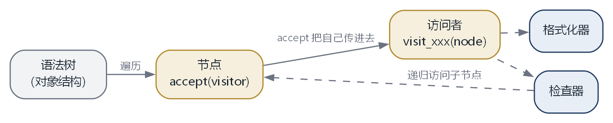

# 第 23 章 访问者：不修改元素类，给它们加新操作

## 23.1 代码检查工具的第四种输出

一个团队给自家的配置语言写了个语法树，节点类型有十来种，赋值、函数调用、条件、循环、字面量、成员访问、列表、映射都在里面。

```text
class AssignNode   { target, value }
class CallNode     { func, args }
class IfNode       { cond, then, else_ }
class LoopNode     { iter, body }
class MemberNode   { obj, name }
...
```

第一个功能是求值，每个节点实现 `eval(env)`。因为求值是这个语言的核心，放在节点里很自然。

第二个功能是静态检查，找未定义变量，找类型不匹配。团队给每个节点加了 `check(context)`。

第三个功能是格式化，按缩进输出代码。又给每个节点加了 `format(indent)`。

第四个功能是转成另一种中间表示。有人提出反对，语法树的类已经被撑到八百行，每加一个节点类型都要改五个文件。

问题很具体：**每次加新功能，都要动所有节点类；每次加新节点，都要动所有功能**。两个方向的变更互相纠缠。

## 23.2 把操作从元素里拿出来

访问者模式的思路是：节点类只保留数据结构，所有“要对节点做的事”抽出来，各自成为独立的访问者对象。节点提供一个统一的“接受访问者”的方法，把控制权交给访问者。

它包含五个角色。

**访问者接口。** 为每种元素类型声明一个访问方法，比如 `visit_assign`、`visit_call`。

**具体访问者。** 一个功能一个类，实现全部访问方法。比如检查器、格式化器、求值器。

**元素接口。** 声明一个 `accept(visitor)` 方法。

**具体元素。** 每个节点类型。它的 `accept` 实现通常只有一行，调用访问者对应的方法，把自己传进去。

**对象结构。** 持有元素集合的对象，比如整棵语法树。它提供遍历入口，让访问者走遍所有节点。

用结构描述。

```text
interface Visitor
  visit_assign(n, ctx)
  visit_call(n, ctx)
  visit_if(n, ctx)
  visit_loop(n, ctx)
  visit_member(n, ctx)

interface Node
  accept(v, ctx)

class AssignNode implements Node
  target, value
  accept(v, ctx) { return v.visit_assign(this, ctx) }

class CallNode implements Node
  func, args
  accept(v, ctx) { return v.visit_call(this, ctx) }

class Checker implements Visitor
  visit_assign(n, ctx) { ctx.define(n.target); n.value.accept(this, ctx) }
  visit_call(n, ctx)
    if not ctx.has(n.func): ctx.report("未定义 " + n.func)
    for a in n.args: a.accept(this, ctx)

class Formatter implements Visitor
  visit_assign(n, ctx) { out(n.target + " = "); n.value.accept(this, ctx) }
```

## 23.3 双重分派

这是访问者模式最核心的机制，值得单独说清楚。

普通的方法调用是单分派。调用 `node.accept(v)` 时，实际执行哪个 `accept`，取决于 `node` 的类型。

进入 `accept` 之后，它调用 `v.visit_xxx(this)`。这一次，执行哪个 `visit_xxx`，取决于 `v` 的类型，而 `xxx` 已经由节点类型确定了。

两次分派叠加起来，最终执行的方法同时取决于“节点的类型”和“访问者的类型”。这就是双重分派。

用一句话概括：节点说“我是赋值节点”，访问者说“我是检查器”，两者一组合，就落到 `Checker.visit_assign`。

这件事用普通的 if-else 也能做到，遍历节点、判断类型、调用对应逻辑。但那样就得在一个地方写十几种分支，而且每加一个功能都要复制一遍这个分支结构。双重分派把“选哪个方法”交给了语言本身。

## 23.4 两跳调用长什么样

在 C++ 里，这套机制只需要两个基类加一组重载。

```cpp
struct AssignNode;   // 前向声明，给 Visitor 的重载用
struct CallNode;

struct Visitor {
    virtual ~Visitor() = default;
    virtual void visit(AssignNode& n) = 0;
    virtual void visit(CallNode& n)  = 0;
};

struct Node {
    virtual void accept(Visitor& v) = 0;
    virtual ~Node() = default;
};

struct AssignNode : Node {
    std::string           target;
    std::unique_ptr<Node> value;
    void accept(Visitor& v) override { v.visit(*this); }
};

struct CallNode : Node {
    std::string                        func;
    std::vector<std::unique_ptr<Node>> args;
    void accept(Visitor& v) override { v.visit(*this); }
};
```

拆开看两跳各自靠什么。

第一跳 `node->accept(v)` 里，`node` 是基类指针，`accept` 是虚函数，按 `node` 的动态类型选中 `AssignNode::accept`。

进了 `AssignNode::accept`，`*this` 的静态类型已经是 `AssignNode`，编译器据此把 `v.visit(*this)` 解析到接受 `AssignNode&` 的那个重载上。这一步在编译期定下来。接下来真正的调用再按 `v` 的虚表分派，落到 `Checker::visit(AssignNode&)`。

两次分派中间夹着一次重载决议，这就是双重分派在 C++ 里的实现方式。重载决议必须发生在第一跳之后，因为只有进了 `accept` 才知道自己是哪种节点。

不用双重分派也能写，代价在另一处。

```cpp
void check(Node* n, Context& ctx) {
    if (auto a = dynamic_cast<AssignNode*>(n))      { /* ... */ }
    else if (auto c = dynamic_cast<CallNode*>(n))   { /* ... */ }
    else { ctx.report("未知节点"); }
}
```

这段能跑，但有两个缺点。每次访问都要做一次运行期类型比较，树深一万层就是一万次；每加一个节点类型，所有这种分发函数都要补一个分支，成本跟访问者一样。唯一的好处是不用改节点类，适合节点类不在自己手里的场景。



## 23.5 协作过程

1. 用户点“检查”，系统创建一个 `Checker` 访问者。
2. 系统把整棵语法树交给对象结构，开始遍历。
3. 走到一个赋值节点，调用它的 `accept`。
4. `accept` 调用 `Checker.visit_assign`，把自己和上下文传过去。
5. 检查器在 `visit_assign` 里做两件事：登记这个变量已定义，然后递归访问右值节点。
6. 递归访问右值时，又会走一遍第 3 到第 5 步，落到对应的方法上。
7. 遇到未定义变量，检查器记一条问题，继续走。

整个过程中，节点类只做了一件事，把自己的类型告诉访问者。所有业务逻辑都在访问者里。

## 23.6 新增功能的代价

改造之后，加一个功能的成本变了。

**加功能。** 写一个新的访问者类，实现全部访问方法。节点类一行不改。这是访问者模式最大的收益。

**加节点类型。** 所有访问者都要加一个方法。访问者有几个，就要改几个文件。

所以访问者模式有一个明确的适用条件：**元素类型稳定，操作频繁增加**。

编译器、静态分析、报表导出、序列化，都符合这个条件：节点类型一旦定下来很少变，而每过一段时间就要加一种输出或者一种检查。

反过来，如果一个系统里节点类型每周都在加，访问者模式会让每次新增都变成全局改动，比原来的写法更糟。

## 23.7 元素类型要增长时

访问者的成立条件是元素类型稳定。现实里这个条件经常被打破，比如语言加了个 `try` 语句，或者规范化阶段往树里插了新的内部节点。

如果增长可预期，有两个缓冲办法。

第一，给访问者接口一个兜底方法。基础的那个 `visit` 写成非纯虚，具体重载按需实现。

```cpp
struct Visitor {
    virtual void visit(Node& n)       { /* 默认不处理 */ }
    virtual void visit(AssignNode& n) { visit(static_cast<Node&>(n)); }
    virtual void visit(CallNode& n)   { visit(static_cast<Node&>(n)); }
};
```

代价是漏写不再报错。新节点加进来，十个访问者里九个静默走了兜底，输出少了一类内容，没人知道。所以兜底里至少要记一条日志，或者把“未处理类型”计数上报，让漏写变得可观测。

第二，把访问者拆成两组接口。核心节点一组，扩展节点一组，需要处理扩展节点的访问者才实现第二组。这样加扩展节点只影响少数访问者，而不是全部。

真正要警惕的是“增长远快于预期”。半年内节点从十种加到三十种，访问者模式已经把你们拖进了每加一种节点改十个文件的境地，这时候应该退回去用多态方法或者模式匹配，而不是硬撑。

## 23.8 访问者要带状态怎么办

访问者通常是“一次遍历一个结果”，但真实功能经常需要累积状态。

**上下文参数。** 每个 `visit` 方法都接收一个上下文对象，访问者把状态放在上下文里。这样访问者本身可以无状态、可复用。

**访问者自己持有状态。** 一个访问者实例对应一次遍历，遍历完从它身上取结果。简单，但访问者不能跨遍历复用。

**返回值累积。** 每个 `visit` 返回一个结果，由父节点的 `visit` 合并。适合“计算某个值”的场景，比如统计节点数量、计算复杂度。

选哪种取决于结果形态。要生成一段文本，用上下文里的输出缓冲最自然；要算一个数，用返回值累积最清楚。

访问者自己持状态时还有一个规矩，一次遍历一个实例。把同一个访问者对象缓存起来跨请求复用，上一个请求的累积值会留在里面，症状是“第一次报表正确，刷新一次就翻倍”。

## 23.9 访问者与遍历的关系

访问者只负责“访问到一个节点时做什么”，不负责“怎么走到下一个节点”。

遍历的方式有两种。

**节点自己递归。** 每个 `visit` 方法里主动访问子节点。控制灵活：可以只访问一部分、可以改变顺序、可以在中间插入逻辑。

**对象结构统一遍历。** 先遍历出节点序列，再逐个交给访问者。访问者不关心树结构。

第一种更常见，因为大多数分析需要在访问子节点之前或之后做事。第二种适合“顺序无关的批处理”。

## 23.10 与迭代器的区别

**迭代器**负责“怎么按顺序访问元素”，它解决的问题是遍历。

**访问者**负责“访问到时做什么”，它解决的问题是给元素加操作。

两者可以配合：用迭代器走遍节点，把每个节点交给访问者。但访问者模式通常自带递归遍历，因为分析往往需要知道父子关系。

## 23.11 与多态的区别

如果某个操作是所有元素都必须支持的，而且将来也不会增加新操作，那把它做成元素的方法（多态）最直接，不需要访问者。

访问者的价值在于“操作会不断增加，而元素类型相对稳定”。这是开闭原则的一个具体应用：对扩展开放（加访问者），对修改关闭（不改元素）。

但如果元素类型也在变，这个平衡就被打破了。判断依据永远是两个方向哪个变得更快。

## 23.12 四种写法的对照

| 写法 | 加一种操作 | 加一种元素 | 能读私有数据 | 编译期检查 |
|---|---|---|---|---|
| 多态方法 | 改所有元素类 | 只改新类 | 能 | 强，漏了不编译 |
| 访问者 | 加一个类 | 改所有访问者 | 能，靠 friend 或访问器 | 强，纯虚漏了不编译 |
| 类型 switch | 改所有分发函数 | 只改分发函数 | 不能 | 弱，漏了走 else |
| 模式匹配 | 改所有匹配处 | 只改新类型 | 取决于语言 | 中，靠穷尽性检查 |

选型看前两列的对比。加操作远多于加元素，选访问者；两者差不多，选多态；元素来自外部、改不了，选访问者或类型 switch。

## 23.13 十个访问者，三十种节点

有个报表系统用访问者处理查询计划，开始十种节点、六个访问者，六十个方法，还算能接受。

两年后节点增到二十八种，访问者增到十个。加一种节点要改十个文件，其中一个访问者漏改了，新节点静默走了兜底，报表少算了一类表达式。这个错持续了三个月，最后是财务对账时发现某类产品的毛利总是偏高。

收拾分三步。先把节点按稳定性分成核心十二种和扩展十六种，访问者接口跟着拆成两个；再给扩展部分加兜底和未处理计数，计数不为零就告警；最后补一个覆盖率测试，遍历测试用例里的所有节点类型，断言每一种都至少被一个具体访问方法命中过。

第三步最值钱。访问者的风险不是写不出来，而是写漏了没人知道。编译器只能保证接口里的方法都实现了，保证不了新加的类型有没有对应的处理。

## 23.14 什么时候不该用它

**元素类型会频繁增加。** 每加一种节点，所有访问者都要改，成本随访问者数量线性增长。

**只有一两个操作。** 两个功能，直接在节点里写两个方法，比建两套访问者体系简单得多。

**元素之间需要大量互相调用。** 访问者模式把逻辑从元素里抽走，元素之间如果本来就要频繁协作，抽走之后反而要来回传上下文。

**语言支持模式匹配。** 很多现代语言可以直接对类型做模式匹配，写起来接近访问者但不需要 `accept` 方法。这种情况下，模式匹配通常更简洁，代价是元素类型不能完全封闭。

## 23.15 一个判断标准

要不要用访问者，看三点。

第一，有一批结构稳定的元素，需要在其上不断加新操作？是，访问者是最合适的解法。

第二，加操作时不能修改元素类？是，比如元素类在第三方库里，或者已经被大量代码依赖。

第三，元素类型未来会保持稳定？是，访问者的成本可控；不是，先别用。

判断的核心是一句权衡：**访问者把“加功能容易”换成了“加类型困难”**。这个交换划不划算，取决于你的系统里哪个方向变得更快。

回到开头那棵语法树。第四种输出最后没有写进节点类，而是成了一个独立访问者。上线之后团队又加了两种检查、一种序列化，节点类一行没动。这个模式的价值不在结构巧妙，而在于它把一个方向的变化成本压到接近零，同时把另一个方向的成本抬高。任何模式都是这样一笔交易，没有白拿的解耦。

二十三种解法看下来，各自回答的问题可以归到四处。对象怎么来，是创建型要解决的；对象怎么拼，是结构型要解决的；一次请求在几个对象之间怎么流转，是行为型要解决的。剩下那一处最容易被忽略，变化从哪个方向来。同一个“把算法抽出来”的动作，在算法会增加时是策略，在阶段会转移时是状态，在需要拦截和改写时是中介者。

所以选型时最有用的问题不是“这像哪个模式”，而是两句更朴素的话。这里的变化来自哪个方向，谁会来改这段代码。答案清楚了，模式自己会浮出来；答案不清楚，套哪个模式都只是把复杂度挪了个位置。
